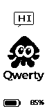
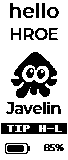

# StenoSquid

✅ZMK Wireless Keyboard\
✅PloverHID\
✅Javelin onboard steno\
🤌🍇 Wireless dictionary editing\
🦑 Practice with just your keyboard!\
📚 Tested: 900,000+ total stored entries on 16 MiB!

**Firmware for `Boardsource Wireless Corne SMT` && https://github.com/disarmyouwitha/StenoSquid-PCB** \
(But it should work with any nRF52840 microcontroller + a 16 MiB `Adafruit #5634` QSPI breakout!)

 —  —  —  — 

[ZMK](https://github.com/zmkfirmware/zmk) handles the keyboard, Bluetooth, power management, and keymap editing. \
[Javelin](https://github.com/jthlim/javelin-steno) handles onboard steno translation.

## Keyboard Modes

| Mode | Output |
| --- | --- |
| **Qwerty** | Ordinary keyboard input through ZMK. |
| **Numpad** | Arrow keys, a number pad, and Bluetooth controls. Hold the middle left thumb to use it. |
| **Javelin** | Onboard dictionary translation, including spelling rules, repeat, and undo. Works with Plover closed. |
| **Plover** | Raw steno strokes sent over Plover HID to Plover on the computer, using Plover's dictionaries. |
| **Practice** | Offline practice drills using only your keyboard, no PC required! |

## Factory Dictionaries

| Dictionary | Compiled size |
| --- | ---: |
| Personal dictionary | Live journal (varies) |
| Lapwing Commands | 3.4 KiB |
| Lapwing Numbers | 2.6 KiB |
| Lapwing UK Additions | 199.5 KiB |
| Lapwing Proper Nouns | 253.4 KiB |
| Lapwing Base | 1.75 MiB |
| Plover Base | 2.23 MiB |

The full factory set contains 291,403 entries. A test stored 918,000 compiled entries across 16 dictionaries on 16 MiB of flash.

You can set active dictionary and priorities in `StenoSquidManager.html`. Selections and personal edits survive reboot and firmware updates. With every dictionary disabled, Javelin outputs literal outlines such as `KAT`.

## Practice Mode

From the Javelin or Plover layer, tap the outer right thumb

| Drill | Prompts | Checks |
| --- | ---: | --- |
| WORDS | 10 | Ten different words from a verified pool of 300 common Lapwing words, weighted toward mistakes, slow answers, and less-recent practice. |
| LEFT | 30 | Random left-hand keys. |
| RIGHT | 30 | Random right-hand keys. |
| COLUMNS | 30 | Paired keys: TK, PW, HR, FR, PB, LG, TS, DZ, AO, and EU. |
| Build-Up | 10 | Build K → KA → KA-T, reveal CAT, then repeat KA-T with CAT visible. |
| Multi- | 10 | Ten distinct two-stroke words from 20 verified common Lapwing outlines. |
| SPEED | 10 / 30 seconds | Ten distinct words from the 300-word pool, with immediate advancement and a live countdown. |
| TROUBLE | 10 | Focused repetitions of words your saved history marks as difficult. |

## How to Install

⭐ **[Download your bundle](https://github.com/disarmyouwitha/StenoSquid/releases/latest)**
**&& Use `StenoSquidManager.html` to install and edit dictionaries!**

### Provision a new Keyboard

1. **[Download your bundle](https://github.com/disarmyouwitha/StenoSquid/releases/latest)**: **`boardsource.zip`** or **`nicenano.zip`**. Extract it and flash its **`Left.uf2`** and **`Right.uf2`** to the matching halves. Use the same pair with or without a nice!view. (Practice uses the right display.)
2. Open the included **`StenoSquidManager.html` in Chrome** (or Edge). No installation needed.
3. Plug the **left half into USB**, click **Connect** in Manager, and allow the browser to access your keyboard.
4. In **Set up dictionaries**, choose the factory dictionaries you want and click **Install selected dictionaries**. Confirm the initial setup, which prepares the external dictionary pool, and keep USB connected until Manager reports that the keyboard is ready.

#### Use offline `StenoSquidManager.html` to edit translations, import/export dictionaries and manage memory~
*(Also available online @ [https://ranna.ink/StenoSquidManager.html](https://ranna.ink/StenoSquidManager.html))*\
We still offer compatibility with [Javelin Steno Tools](https://lim.au/#/software/javelin-steno-tools) for basic dictionary tools.

## ZMK Studio
ZMK Studio edits the keymap over USB (or Bluetooth with the Desktop app)!

Javelin and Plover HID bindings have separate parameters for the visible key label and the actual steno key. Change the steno identity to change what a key sends.

Saved Studio keymaps take precedence over the source keymap. To load updated defaults, use **Restore stock settings**, which replaces saved keymap edits. Renamed layers appear on the nice!view after a layer change. Only the first nine characters are sent across the split, and only plain ASCII.

https://zmk.studio/

## Default Keymap 

### Qwerty

### Numpad

### Javelin

## External Flash Map
**`StenoSquidManager.html`** shows the current memory layout.

## NiceNano Wiring Diagram

**Components used in handwired build**
* [Adafruit #5634 QSPI breakout](https://www.adafruit.com/product/5634)
* [10K ohm Resistor](https://www.amazon.com/dp/B07HDGX5LM)
* [100 nF ceramic capacitor](https://www.amazon.com/dp/B07X5XTDPB)

The 10 kΩ resistor connects CS# to the flash's switched 3.3 V supply.
The 100 nF ceramic capacitor connects across flash VCC/GND. Both are nonpolarized.
Wire the Adafruit #5634's exposed IO2 and IO3 pads directly.
[Adafruit pinout](https://learn.adafruit.com/adafruit-qspi-dip-breakout-boards/pinouts)

[Technical documentation](docs/README.md) covers the storage design, hardware results, and development checks.

## License

StenoSquid’s own code is available under the [0BSD license](LICENSE).
The Javelin steno engine is licensed under PolyForm Noncommercial 1.0.0. Dependencies and dictionary sources retain their respective licenses. [Javelin license](https://github.com/jthlim/javelin-steno/blob/22726675b2dcf3b8b6ba1e20898f25e324b2260a/LICENSE.txt)
