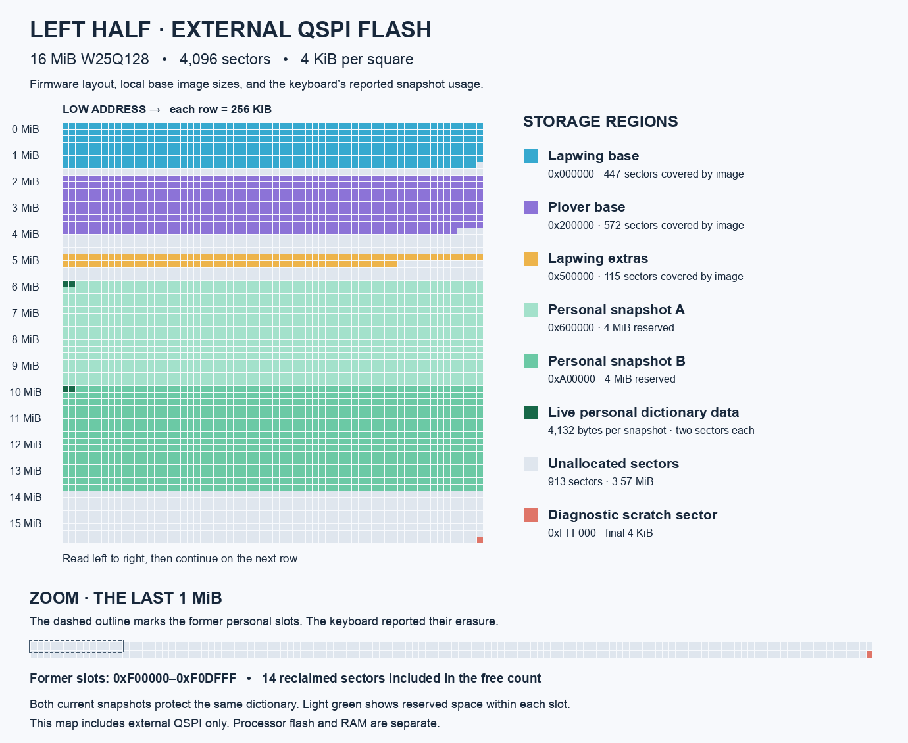

# Steno Squid

**Firmware for `Boardsource Wireless Corne SMT` && https://github.com/disarmyouwitha/StenoSquid-PCB** \
(But it should work with any with any nRF52840 microcontroller with a 16 MiB W25Q128 QSPI flash chip!)

✅ZMK Wireless Keyboard\
✅PloverHID\
✅Javelin onboard steno\
🤌🍇 Wireless dictionary updates\
🦑 Practice with just your keyboard!

[ZMK](https://github.com/zmkfirmware/zmk) handles the keyboard, Bluetooth, power management, and keymap editing. [Javelin](https://github.com/jthlim/javelin-steno) handles onboard steno translation.

The `steno-squid/locked-pin-map` branch also targets the Boardsource Wireless
Corne SMT with the locked Steno Squid expansion pinout. This hardware port is
awaiting on-device bring-up. [Boardsource build and pinout](config/boardsource-wireless-corne/README.md)

## Keyboard modes and controls

| Mode | Output |
| --- | --- |
| **Qwerty** | Ordinary keyboard input through ZMK. |
| **Numpad** | Arrow keys, a number pad, and Bluetooth controls. Hold the middle left thumb to use it. |
| **Javelin** | Onboard dictionary translation, including spelling rules, repeat, and undo. Works with Plover closed. |
| **Plover** | Raw steno strokes sent over Plover HID to Plover on the computer, using Plover's dictionaries. |

## Onboard dictionaries

| Dictionary | Default |
| --- | --- |
| Personal dictionary | On |
| Lapwing Commands | On |
| Lapwing Numbers | On |
| Lapwing UK Additions | **Off** |
| Lapwing Proper Nouns | On |
| Lapwing Base | On |
| Plover Base | **Off** |

Personal entries have highest priority, followed by the other dictionaries in order. Selections and personal edits survive reboot and firmware updates. Enable Plover Base and disable Lapwing Base to switch bases. With every dictionary disabled, Javelin outputs literal outlines such as `KAT`.

## Practice Mode

From the Javelin or Plover layer, tap the outer right thumb

| Drill | Prompts | Checks |
| --- | ---: | --- |
| WORDS | 10 | Ten different words from a verified pool of 300 common Lapwing words, weighted toward mistakes, slow answers, and less-recent practice. |
| LEFT | 30 | Random left-hand consonant keys. |
| RIGHT | 30 | Random right-hand consonant keys. |
| COLUMNS | 30 | Paired keys: TK, PW, HR, FR, PB, LG, TS, DZ, AO, and EU. |
| Build-Up | 10 | Three growing chords per ladder, then a word reveal: K → KA → KA-T → CAT. |
| Multi- | 10 | Ten distinct two-stroke words from 20 verified common Lapwing outlines. |
| SPEED | 10 / 30 seconds | Ten distinct words from the 300-word pool, with immediate advancement and a live countdown. |
| TROUBLE | 10 | Focused repetitions of words your saved history marks as difficult. |

## Default Keymap

### Qwerty


### Numpad


### Javelin


## ZMK Studio (Edit keymap)
ZMK Studio edits the keymap over USB (or Bluetooth with the Desktop app)!

Javelin and Plover HID bindings have separate parameters for the visible key label and the actual steno key. Change the steno identity to change what a key sends.

Saved Studio keymaps take precedence over the source keymap. To load updated defaults, use **Restore stock settings**, which replaces saved keymap edits. Renamed layers appear on the nice!view after a layer change. Only the first nine characters are sent across the split, and only plain ASCII.

https://zmk.studio/

## Javelin Wireless Dictionary Management
1. Connect the left half by USB or Bluetooth!
2. Open Javelin Steno Tools in Chrome, choose **Connect via HID**, and select the keyboard.
3. Use **Active Dictionaries** to change selections and **Dictionary Management → View** to add, replace, remove, or export personal entries.
4. Use **Host Layout** to select **Mac U.S.** or **Windows U.S. (plain text)**. The keyboard remembers the choice.

Mac U.S. supports accents using the U.S./ABC input source. Windows U.S. uses ordinary U.S. keystrokes and converts accented Latin letters to plain equivalents, such as **ç → c**.

https://lim.au/#/software/javelin-steno-tools

## External Memory Map
The compiled base and extras images occupy about 4.43 MiB of external flash. The personal dictionary is read directly from QSPI and has two 4 MiB snapshot slots. Saves compact the live entries and verify the replacement before switching to it. Initial dictionary installation uses the left half's diagnostics serial port. [Provisioning and flash layout](config/steno-squid-split/README.md#flash-regions-and-initial-plover-provisioning)



The dark green sectors show a one-entry dictionary. The lighter green sectors are reserved for growth.

## Build and install

GitHub Actions builds these UF2 artifacts from the pinned dependencies:

| Artifact | Use |
| --- | --- |
| **left-studio** | Everyday left-half firmware with Studio over USB and Bluetooth. |
| **left-logging** | Left-half firmware with the serial port used for dictionary installation and diagnostics. |
| **right-nice-view** | Right-half firmware with the portrait display, squid, and Practice UI. |
| **right** | Right-half firmware without the display. |

This branch also builds **boardsource-left-studio**, **boardsource-left-logging**,
**boardsource-right**, **boardsource-probe**, and **boardsource-quad** for the
Boardsource hardware. Follow the linked bring-up guide for those targets.

Download artifacts from a successful run. Double-tap RESET on the intended controller and copy its UF2 to the **NICENANO** drive. Install matching left and right firmware when updating Practice or split-display features. [Firmware builds](https://github.com/disarmyouwitha/StenoSquid/actions/workflows/build.yml)

For a new keyboard, prepare the dictionary images using the build guides, flash **left-logging**, and install them through its diagnostics port using Python with the `pyserial` package. Substitute the actual serial device path:

```sh
python3 tools/steno-squid-lapwing/upload.py /dev/cu.usbmodem14501
```

The uploader installs missing configured images from `build/`. Use `--status` to inspect them or `--verify` for a full CRC check. After provisioning, flash **left-studio** for everyday use. Dictionary images are uploaded separately from the UF2 firmware.

Local builds must use this checkout's west manifest. If the workspace keeps a separate manifest copy, synchronize it before running `west update`. The compiled dictionary format depends on the pinned Javelin engine. [Dependency manifest](config/west.yml)

## License

The Javelin steno engine is licensed under PolyForm Noncommercial 1.0.0. Dependencies and dictionary sources retain their respective licenses. [Javelin license](https://github.com/jthlim/javelin-steno/blob/22726675b2dcf3b8b6ba1e20898f25e324b2260a/LICENSE.txt)
