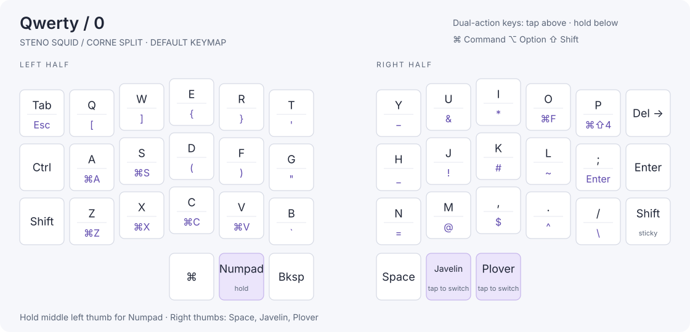

# StenoSquid

✅ZMK Wireless Keyboard\
✅PloverHID\
✅Javelin onboard steno\
🤌🍇 Wireless dictionary updates\
🦑 Practice with just your keyboard!\
📚 Room for ~190,000 personal dictionary entries!

**Firmware for `Boardsource Wireless Corne SMT` && https://github.com/disarmyouwitha/StenoSquid-PCB** \
(But it should work with any nRF52840 `Nice!Nano` microcontroller + a 16 MiB `Adafruit #5634` QSPI breakout!)

 —  —  —  — 

[ZMK](https://github.com/zmkfirmware/zmk) handles the keyboard, Bluetooth, power management, and keymap editing. \
[Javelin](https://github.com/jthlim/javelin-steno) handles onboard steno translation.

## Keyboard modes

| Mode | Output |
| --- | --- |
| **Qwerty** | Ordinary keyboard input through ZMK. |
| **Numpad** | Arrow keys, a number pad, and Bluetooth controls. Hold the middle left thumb to use it. |
| **Javelin** | Onboard dictionary translation, including spelling rules, repeat, and undo. Works with Plover closed. |
| **Plover** | Raw steno strokes sent over Plover HID to Plover on the computer, using Plover's dictionaries. |
| **Practice** | Offline practice drills using only your keyboard, no PC required! |

## Onboard dictionaries

| Dictionary | Default |
| --- | --- |
| Personal dictionary | On |
| Lapwing Commands | On |
| Lapwing Numbers | On |
| Lapwing UK Additions | **Off** |
| Lapwing Proper Nouns | On |
| Lapwing Base | On |
| Plover Base | **Off** |

Personal entries have highest priority, followed by the other dictionaries in order. Selections and personal edits survive reboot and firmware updates. Enable Plover Base and disable Lapwing dictionaries to switch bases. With every dictionary disabled, Javelin outputs literal outlines such as `KAT`.

## Practice Mode

From the Javelin or Plover layer, tap the outer right thumb

| Drill | Prompts | Checks |
| --- | ---: | --- |
| WORDS | 10 | Ten different words from a verified pool of 300 common Lapwing words, weighted toward mistakes, slow answers, and less-recent practice. |
| LEFT | 30 | Random left-hand keys. |
| RIGHT | 30 | Random right-hand keys. |
| COLUMNS | 30 | Paired keys: TK, PW, HR, FR, PB, LG, TS, DZ, AO, and EU. |
| Build-Up | 10 | Three growing chords per ladder, then a word reveal: K → KA → KA-T → CAT. |
| Multi- | 10 | Ten distinct two-stroke words from 20 verified common Lapwing outlines. |
| SPEED | 10 / 30 seconds | Ten distinct words from the 300-word pool, with immediate advancement and a live countdown. |
| TROUBLE | 10 | Focused repetitions of words your saved history marks as difficult. |

## How to install

⭐️ **[Download firmware](https://github.com/disarmyouwitha/StenoSquid/releases)** —  Download the UF2s for your board and install the matching left and right halves.

### Provision a new keyboard

1. Flash the matching **Left** and **Right** UF2s. Use the **No-Display** pair if you don't have a nice!view.
2. Plug the left half in over USB, close any Javelin browser connection, and run these commands from this repository.

   ```sh
   python3 -m pip install hidapi
   python3 stenosquid.py --install
   ```

   The installer downloads and prepares missing dictionaries, writes them to the left half, and verifies them. You can use Javelin as soon as the installer finishes. If interrupted, reconnect USB and rerun the same command.

If the installer reports a conflict, run `python3 stenosquid.py --repair` to check
all configured base images and replace the ones that need repair.
The personal dictionary stays intact.

### Import a personal Plover dictionary

With the current **Left** firmware connected by USB, close the Javelin browser connection and run:

```sh
python3 stenosquid.py --import user.json
```

The file's translations win for matching outlines. Other personal entries stay in the dictionary. A small change is sent as individual edits. A large one is built into whole flash segments on your computer, uploaded, and checked by the keyboard before it is committed. If the keyboard has no room to keep your current dictionary during the import, the importer first saves the merged dictionary to a timestamped `.backup-*.json` file next to your input, then replaces the keyboard's copy. Keep USB connected through verification and use a plain Plover JSON export. Plover-only formatting commands and plugins may behave differently in onboard Javelin.

### Back up your dictionary

Keep a copy of your personal dictionary on your computer. With the current **Left** firmware connected by USB, close the Javelin browser connection and run:

```sh
python3 stenosquid.py --backup dictionary.json
```

It writes a Plover JSON file and refuses to overwrite an existing one. Restore it later with `--import`.

## Default Keymap 
Edit keymap with [ZMK Studio](https://github.com/disarmyouwitha/StenoSquid#zmk-studio)

### Qwerty



### Numpad


### Javelin


## ZMK Studio
ZMK Studio edits the keymap over USB (or Bluetooth with the Desktop app)!

Javelin and Plover HID bindings have separate parameters for the visible key label and the actual steno key. Change the steno identity to change what a key sends.

Saved Studio keymaps take precedence over the source keymap. To load updated defaults, use **Restore stock settings**, which replaces saved keymap edits. Renamed layers appear on the nice!view after a layer change. Only the first nine characters are sent across the split, and only plain ASCII.

https://zmk.studio/

## Javelin Wireless Dictionary Management
1. Connect the left half by USB or Bluetooth!
2. Open Javelin Steno Tools in **Chrome**, choose **Connect via HID**, and select the keyboard.
3. Use **Active Dictionaries** to change selections and **Dictionary Management → View** to add, replace, remove, or export personal entries.
4. Use **Host Layout** to select **Mac U.S.** or **Windows U.S. (plain text)**. The keyboard remembers the choice.

**Windows U.S. (plain text)** is the default for a standard U.S. input layout. It uses ordinary U.S. keystrokes and converts accented Latin letters to plain equivalents, such as **ç → c**. (On a Mac, select **Mac U.S.** with the U.S. or ABC input source to type **aççents**.)

https://lim.au/#/software/javelin-steno-tools

## External Memory Map
The compiled base and extras images occupy about 4.43 MiB of external flash. The personal dictionary is read directly from QSPI. It uses one region from `0x600000` to `0xFF0000`, split into 159 segments of 64 KiB. Entries are appended to record segments, two hash tables find them by outline and by translation, and a small log says which tables are current. An edit appends one record and writes two table slots instead of rewriting the dictionary, and space from deleted entries is reclaimed one segment at a time. Every record carries a checksum, and the tables can be rebuilt from the records.


The dark green sectors show a one-entry dictionary. The lighter green sectors are reserved for growth.

## NiceNano Wiring Diagram


**Components used in handwired build**
* [Adafruit #5634 QSPI breakout](https://www.adafruit.com/product/5634)
* [10K ohm Resistor](https://www.amazon.com/dp/B07HDGX5LM)
* [100 nF ceramic capacitor](https://www.amazon.com/dp/B07X5XTDPB)

The 10 kΩ resistor connects CS# to the flash's switched 3.3 V supply.
The 100 nF ceramic capacitor connects across flash VCC/GND. Both are nonpolarized.
Wire the Adafruit #5634's exposed IO2 and IO3 pads directly.
[Adafruit pinout](https://learn.adafruit.com/adafruit-qspi-dip-breakout-boards/pinouts)

## License

The Javelin steno engine is licensed under PolyForm Noncommercial 1.0.0. Dependencies and dictionary sources retain their respective licenses. [Javelin license](https://github.com/jthlim/javelin-steno/blob/22726675b2dcf3b8b6ba1e20898f25e324b2260a/LICENSE.txt)
