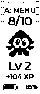
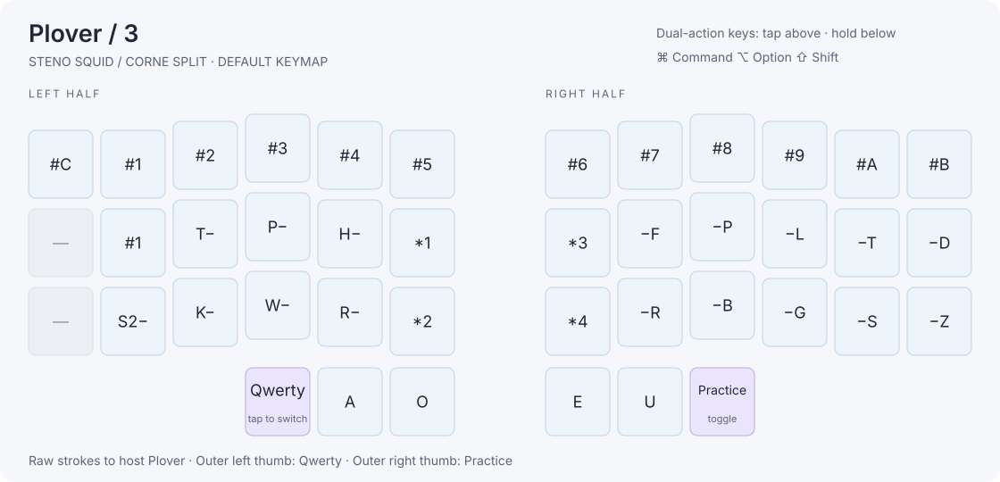
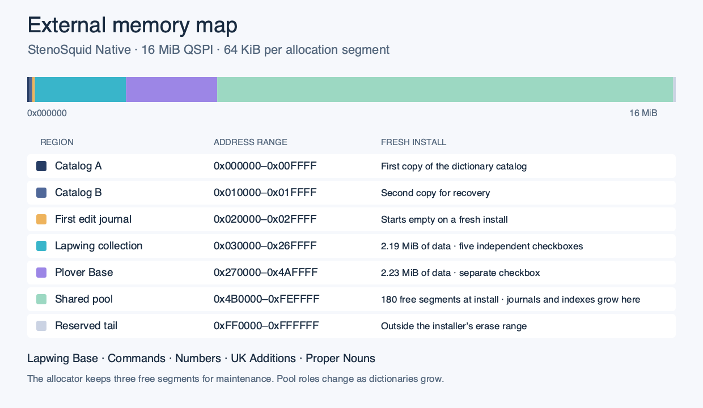
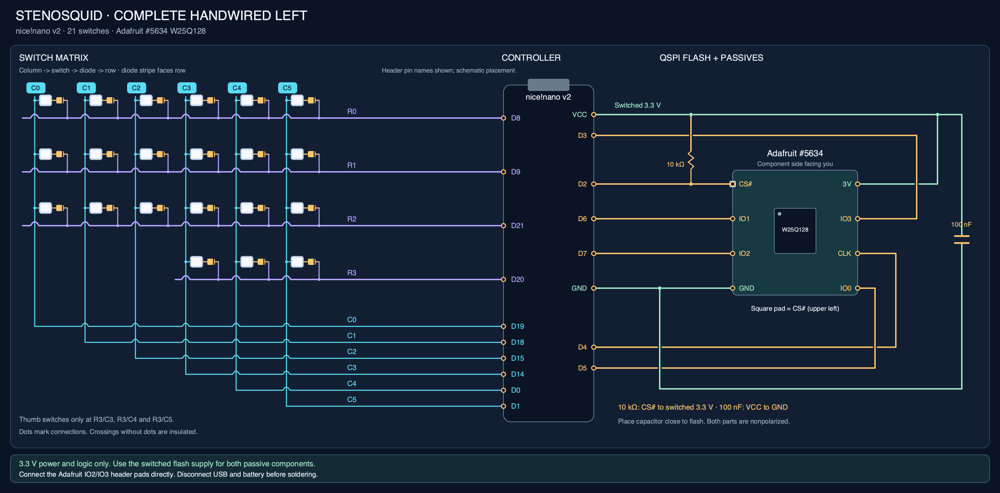

# StenoSquid

✅ZMK Wireless Keyboard\
✅PloverHID\
✅Javelin onboard steno\
🤌🍇 Wireless dictionary updates\
🦑 Practice with just your keyboard!\
📚 Shared 16 MiB onboard dictionary storage

**Firmware for `Boardsource Wireless Corne SMT` && https://github.com/disarmyouwitha/StenoSquid-PCB** \
(But it should work with any nRF52840 `Nice!Nano` microcontroller + a 16 MiB `Adafruit #5634` QSPI breakout!)

 —  —  —  — 

[ZMK](https://github.com/zmkfirmware/zmk) handles the keyboard, Bluetooth, power management, and keymap editing. \
[Javelin](https://github.com/jthlim/javelin-steno) handles onboard steno translation.

## Keyboard modes

| Mode | Output |
| --- | --- |
| **Qwerty** | Ordinary keyboard input through ZMK. |
| **Numpad** | Arrow keys, a number pad, and Bluetooth controls. Hold the middle left thumb to use it. |
| **Javelin** | Onboard dictionary translation, including spelling rules, repeat, and undo. Works with Plover closed. |
| **Plover** | Raw steno strokes sent over Plover HID to Plover on the computer, using Plover's dictionaries. |
| **Practice** | Offline practice drills using only your keyboard, no PC required! |

## Onboard dictionaries

| Dictionary | Default |
| --- | --- |
| Personal dictionary | On |
| Lapwing Commands | On |
| Lapwing Numbers | On |
| Lapwing UK Additions | **Off** |
| Lapwing Proper Nouns | On |
| Lapwing Base | On |
| Plover Base | **Off** |

Personal entries have highest priority, followed by the other dictionaries in order. Selections and personal edits survive reboot and firmware updates. Enable Plover Base and disable Lapwing dictionaries to switch bases. With every dictionary disabled, Javelin outputs literal outlines such as `KAT`.

## Practice Mode

From the Javelin or Plover layer, tap the outer right thumb

| Drill | Prompts | Checks |
| --- | ---: | --- |
| WORDS | 10 | Ten different words from a verified pool of 300 common Lapwing words, weighted toward mistakes, slow answers, and less-recent practice. |
| LEFT | 30 | Random left-hand keys. |
| RIGHT | 30 | Random right-hand keys. |
| COLUMNS | 30 | Paired keys: TK, PW, HR, FR, PB, LG, TS, DZ, AO, and EU. |
| Build-Up | 10 | Build K → KA → KA-T, reveal CAT, then repeat KA-T with CAT visible. |
| Multi- | 10 | Ten distinct two-stroke words from 20 verified common Lapwing outlines. |
| SPEED | 10 / 30 seconds | Ten distinct words from the 300-word pool, with immediate advancement and a live countdown. |
| TROUBLE | 10 | Focused repetitions of words your saved history marks as difficult. |

## How to install

⭐️ **[Download firmware](https://github.com/disarmyouwitha/StenoSquid/releases)** —  Download the UF2s for your board and install the matching left and right halves.

### Provision a new keyboard

1. Flash the matching **Left** and **Right** UF2s. Use the **No-Display** pair if you don't have a nice!view.
2. Plug the left half in over USB, close any Javelin browser connection, and run these commands from this repository.

   ```sh
   python3 -m pip install hidapi
   python3 stenosquid.py --install --confirm-erase
   ```

   This prepares the pinned dictionaries, replaces the external dictionary pool, and verifies the result. If a fresh install is interrupted, reconnect USB and rerun the same command. On a provisioned board, use `--install` without `--confirm-erase` to check that it is already installed.

### Update firmware

Boards on the current Native QSPI layout keep their dictionaries when you flash
the new Left UF2. For a board with an older QSPI layout, flash the new firmware
and run the clean provisioning command above. Provisioning replaces the dictionary pool.

### Steno Squid Manager

Connect the left half over USB and close any Javelin Steno Tools connection. Run
`python3 stenosquid.py --manager` from the repository. The local Manager opens in
your browser. Select **Connect over USB** to view priority and checkboxes, edit
a specific dictionary, import Plover JSON, export an individual dictionary or
download a full backup. The Manager can rename or delete independent dictionaries
and switch the keyboard’s host layout.
**Check pinned updates** compares the installed revisions against this checkout.
Updates keep local edits and report any outlines where upstream also changed.

**Consolidate edits** folds saved edits into a user-owned compact dictionary.
Named imports preview Journal and Compact formats and recommend a fit.
**Download full backup** saves the entire dictionary store, including compact
images and edits, for the separate [USB recovery procedure](docs/adaptive-snapshot-experiment.md#usb-recovery-on-a-spare).

After 64 pending edits, the firmware can rebuild its indexes and reclaim
stale journals while the keyboard is idle on USB power. It can copy up to
4 KiB of live entries to free mostly stale journals and cancels unpublished
work when you resume typing. **Compact now** runs a larger cleanup pass.


### Import a personal Plover dictionary

With the current **Left** firmware connected by USB, close the Javelin browser connection and run:

```sh
python3 stenosquid.py --import user.json
```

The file's translations win for matching outlines. Other personal entries stay in the dictionary. Use a plain Plover JSON export. Plover-only formatting commands and plugins may behave differently in onboard Javelin.

To keep a file separate and give it its own checkbox and lookup priority:

```sh
python3 stenosquid.py --import medical.json --as "Medical"
python3 stenosquid.py --move "Medical" --position 1
```

New named dictionaries start enabled, just below the personal dictionary.
Position 1 has highest priority. Both commands publish over USB and reboot the
left half when done. Use `--status` to see the current order. The firmware
supports 16 dictionaries in total by default.

### Back up your dictionary

Keep a copy of your personal dictionary on your computer. With the current **Left** firmware connected by USB, close the Javelin browser connection and run:

```sh
python3 stenosquid.py --backup dictionary.json
```

It writes a Plover JSON file and refuses to overwrite an existing one. Restore it later with `--import`.

## Default Keymap 
Edit keymap with [ZMK Studio](https://github.com/disarmyouwitha/StenoSquid#zmk-studio)

### Qwerty


### Numpad


### Javelin




## ZMK Studio
ZMK Studio edits the keymap over USB (or Bluetooth with the Desktop app)!

Javelin and Plover HID bindings have separate parameters for the visible key label and the actual steno key. Change the steno identity to change what a key sends.

Saved Studio keymaps take precedence over the source keymap. To load updated defaults, use **Restore stock settings**, which replaces saved keymap edits. Renamed layers appear on the nice!view after a layer change. Only the first nine characters are sent across the split, and only plain ASCII.

https://zmk.studio/

## Javelin Wireless Dictionary Management
1. Connect the left half by USB or Bluetooth!
2. Open Javelin Steno Tools in **Chrome**, choose **Connect via HID**, and select the keyboard.
3. Use **Active Dictionaries** to change selections and **Dictionary Management → View** to add, replace, remove, or export personal entries.
4. Use **Host Layout** to select **Mac U.S.** or **Windows U.S. (plain text)**. The keyboard remembers the choice.

**Windows U.S. (plain text)** is the default for a standard U.S. input layout. It uses ordinary U.S. keystrokes and converts accented Latin letters to plain equivalents, such as **ç → c**. (On a Mac, select **Mac U.S.** with the U.S. or ABC input source to type **aççents**.)

https://lim.au/#/software/javelin-steno-tools

## External Memory Map
Lapwing Base, Commands, Numbers, UK Additions, and Proper Nouns share one compact image and keep their own checkboxes. Plover has its own image. The personal dictionary and indexes grow in the shared QSPI pool. A fresh install leaves 180 free 64 KiB segments, including the three-segment maintenance reserve.



## NiceNano Wiring Diagram


**Components used in handwired build**
* [Adafruit #5634 QSPI breakout](https://www.adafruit.com/product/5634)
* [10K ohm Resistor](https://www.amazon.com/dp/B07HDGX5LM)
* [100 nF ceramic capacitor](https://www.amazon.com/dp/B07X5XTDPB)

The 10 kΩ resistor connects CS# to the flash's switched 3.3 V supply.
The 100 nF ceramic capacitor connects across flash VCC/GND. Both are nonpolarized.
Wire the Adafruit #5634's exposed IO2 and IO3 pads directly.
[Adafruit pinout](https://learn.adafruit.com/adafruit-qspi-dip-breakout-boards/pinouts)

[Technical documentation](docs/README.md) covers the storage design, hardware results, and development checks.

## License

StenoSquid’s own code is available under the [0BSD license](LICENSE).
The Javelin steno engine is licensed under PolyForm Noncommercial 1.0.0. Dependencies and dictionary sources retain their respective licenses. [Javelin license](https://github.com/jthlim/javelin-steno/blob/22726675b2dcf3b8b6ba1e20898f25e324b2260a/LICENSE.txt)
